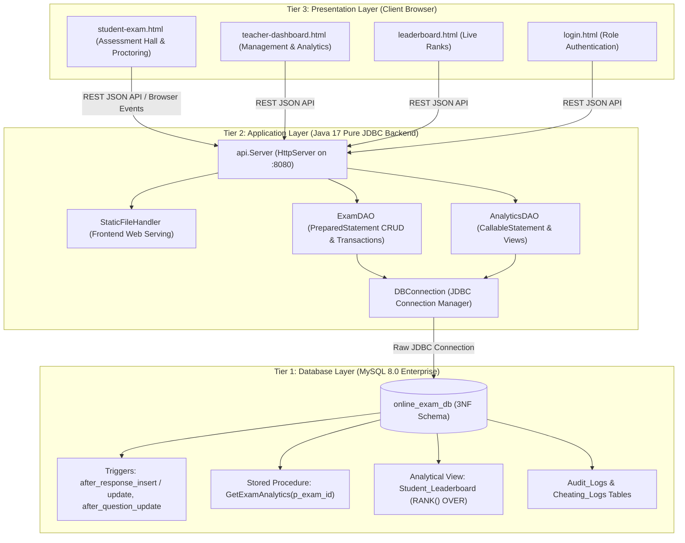
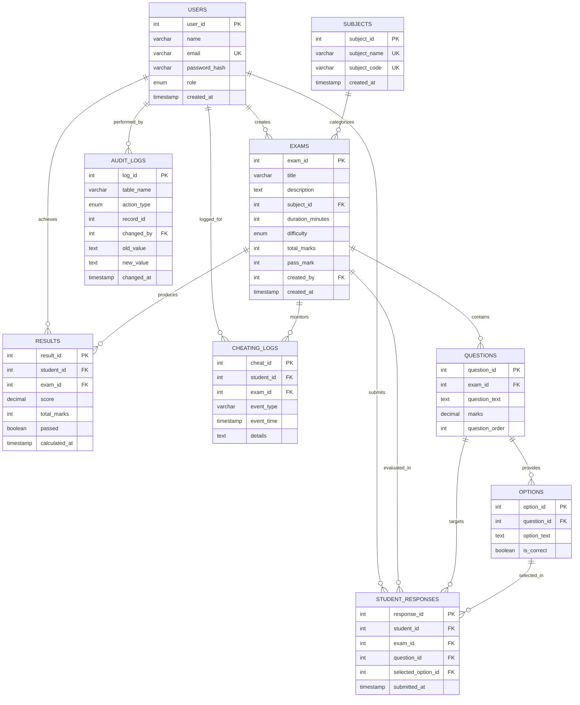
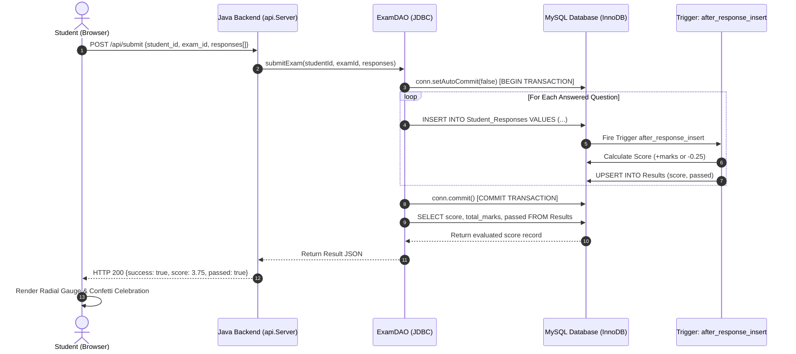
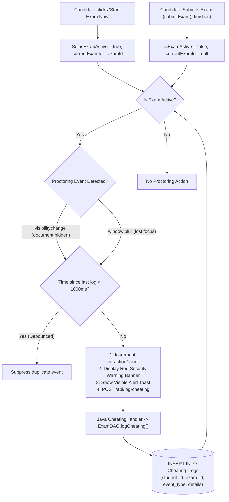

# Comprehensive Database Management Systems (DBMS) Project Report
## 3-Tier Enterprise Online Examination & Proctoring System

---

## 1. Executive Summary & Project Abstract

The **Enterprise Online Examination System** is a robust, production-grade 3-Tier web platform engineered specifically to demonstrate advanced principles of **Relational Database Management Systems (RDBMS)**, ACID-compliant transaction processing, automated business rule enforcement via triggers, analytical processing via stored procedures and window views, and real-time proctoring security.

### Key Architectural Highlights
- **Tier 1 (Database Layer)**: MySQL 8.0 with a fully normalized 3NF relational schema (9 relational tables), primary/foreign keys with cascading actions, automated scoring triggers with -0.25 negative marking, question audit logging triggers, analytical stored procedures, and rank-based leaderboard views.
- **Tier 2 (Application Server)**: Pure Java 17 enterprise backend using Java's built-in `com.sun.net.httpserver.HttpServer` on port 8080 and raw JDBC (`PreparedStatement`, `CallableStatement`, `conn.setAutoCommit(false)`, rollback recovery). **No high-level ORMs or frameworks** (zero Spring Boot / Hibernate) to demonstrate bare-metal database mechanics.
- **Tier 3 (Client Presentation Layer)**: Modern responsive frontend with SaaS design system (Slate/Indigo palette, glassmorphism, SVG countdown timer, dynamic question palette, and canvas confetti), communicating strictly over standard REST JSON APIs.

---

## 2. 3-Tier System Architecture



---

## 3. Relational Schema & 3NF Normalization Analysis

The database consists of 9 relational tables designed in **Third Normal Form (3NF)** to eliminate insert, update, and deletion anomalies.

### 3.1 Entity-Relationship (ER) Diagram



### 3.2 Formal 3NF Normalization Proofs

1. **First Normal Form (1NF)**:
   - Every column contains only atomic (indivisible) values.
   - No repeating groups or arrays exist; options are extracted into a separate child entity `Options`.
   - Primary keys uniquely identify every row.

2. **Second Normal Form (2NF)**:
   - All tables are in 1NF.
   - There are **no partial functional dependencies**. In composite-candidate relationship tables like `Student_Responses`, the unique key is `(student_id, exam_id, question_id)`. Non-key attributes like `selected_option_id` depend entirely on the whole key, not a proper subset.

3. **Third Normal Form (3NF)**:
   - All tables are in 2NF.
   - There are **no transitive dependencies** ($X \rightarrow Y$ and $Y \rightarrow Z$ where $Z$ is non-prime).
   - In `Exams`, subject details (`subject_name`, `subject_code`) are not stored inside `Exams`. Instead, they reside in `Subjects`, referenced strictly via foreign key `subject_id`.
   - In `Questions` and `Options`, question details and option correctness are isolated to avoid redundant question string duplication.

---

## 4. Advanced DBMS Constructs Deep-Dive

### 4.1 Automatic Negative Marking Scoring Triggers
Automated grading is pushed into the database engine through MySQL triggers. When student answers are inserted or updated, the triggers automatically compute positive marks for correct answers and apply **-0.25 negative marking** for incorrect answers.

```sql
DELIMITER $$

CREATE TRIGGER after_response_insert
AFTER INSERT ON Student_Responses
FOR EACH ROW
BEGIN
    DECLARE v_score DECIMAL(5,2) DEFAULT 0.00;
    DECLARE v_total_marks INT DEFAULT 0;
    DECLARE v_pass_mark INT DEFAULT 0;
    DECLARE v_passed BOOLEAN DEFAULT FALSE;

    SELECT total_marks, pass_mark INTO v_total_marks, v_pass_mark
    FROM Exams WHERE exam_id = NEW.exam_id;

    SELECT COALESCE(SUM(
        CASE 
            WHEN sr.selected_option_id IS NULL THEN 0
            WHEN o.is_correct = 1 THEN q.marks
            ELSE -0.25
        END
    ), 0.00) INTO v_score
    FROM Questions q
    LEFT JOIN Student_Responses sr 
        ON sr.question_id = q.question_id 
        AND sr.student_id = NEW.student_id 
        AND sr.exam_id = NEW.exam_id
    LEFT JOIN Options o 
        ON o.option_id = sr.selected_option_id 
        AND o.question_id = q.question_id
    WHERE q.exam_id = NEW.exam_id;

    SET v_passed = (v_score >= (v_pass_mark / 100.0) * v_total_marks);

    INSERT INTO Results (student_id, exam_id, score, total_marks, passed, calculated_at)
    VALUES (NEW.student_id, NEW.exam_id, v_score, v_total_marks, v_passed, NOW())
    ON DUPLICATE KEY UPDATE
        score = v_score,
        total_marks = v_total_marks,
        passed = v_passed,
        calculated_at = NOW();
END$$

DELIMITER ;
```

### 4.2 Data Governance & Audit Trail Trigger
Any update to the `Questions` table (marks modification or question text revision) is captured in `Audit_Logs` for regulatory compliance.

```sql
DELIMITER $$

CREATE TRIGGER after_question_update
AFTER UPDATE ON Questions
FOR EACH ROW
BEGIN
    IF (OLD.question_text <> NEW.question_text) OR (OLD.marks <> NEW.marks) THEN
        INSERT INTO Audit_Logs (
            table_name,
            action_type,
            record_id,
            changed_by,
            old_value,
            new_value,
            changed_at
        ) VALUES (
            'Questions',
            'UPDATE',
            NEW.question_id,
            NULL,
            CONCAT('{"marks": ', OLD.marks, ', "text": "', REPLACE(OLD.question_text, '"', '\\"'), '"}'),
            CONCAT('{"marks": ', NEW.marks, ', "text": "', REPLACE(NEW.question_text, '"', '\\"'), '"}'),
            NOW()
        );
    END IF;
END$$

DELIMITER ;
```

### 4.3 Stored Procedure: Exam Analytics
Encapsulates analytical queries directly within the DBMS engine to compute attempts, average score, maximum score, and pass count for any exam ID.

```sql
DELIMITER $$

CREATE PROCEDURE GetExamAnalytics(IN p_exam_id INT)
BEGIN
    SELECT 
        p_exam_id                                             AS exam_id,
        COUNT(result_id)                                      AS total_attempts,
        ROUND(COALESCE(AVG(score), 0.00), 2)                  AS avg_score,
        ROUND(COALESCE(MAX(score), 0.00), 2)                  AS max_score,
        ROUND(COALESCE(MIN(score), 0.00), 2)                  AS min_score,
        SUM(CASE WHEN passed = TRUE THEN 1 ELSE 0 END)        AS passed_count,
        SUM(CASE WHEN passed = FALSE THEN 1 ELSE 0 END)       AS failed_count
    FROM Results
    WHERE exam_id = p_exam_id;
END$$

DELIMITER ;
```

### 4.4 Analytical View with SQL Window Functions
Provides a real-time student leaderboard utilizing the `RANK() OVER (...)` window function:

```sql
CREATE OR REPLACE VIEW Student_Leaderboard AS
SELECT 
    r.result_id,
    u.user_id                                           AS student_id,
    u.name                                              AS student_name,
    u.email                                             AS student_email,
    e.exam_id,
    e.title                                             AS exam_title,
    s.subject_name,
    r.score,
    r.total_marks,
    r.passed,
    r.calculated_at,
    RANK() OVER (
        PARTITION BY r.exam_id 
        ORDER BY r.score DESC, r.calculated_at ASC
    )                                                   AS `rank`
FROM Results r
JOIN Users u ON u.user_id = r.student_id
JOIN Exams e ON e.exam_id = r.exam_id
LEFT JOIN Subjects s ON s.subject_id = e.subject_id;
```

---

## 5. ACID Transaction Processing & Raw JDBC Implementation

In `backend/src/dao/ExamDAO.java`, exam submission operates under a strict ACID boundary:
- **Atomicity**: Either all student question responses and recalculations commit together, or none do.
- **Consistency**: Foreign keys, check constraints, and trigger invariants remain satisfied.
- **Isolation**: Managed under MySQL's default `REPEATABLE READ` transaction isolation.
- **Durability**: Committed transactions are permanently written to MySQL's InnoDB redo logs.

```java
// Pure JDBC Transaction Boundary in ExamDAO.java
try (Connection conn = DBConnection.getConnection()) {
    conn.setAutoCommit(false); // Begin ACID Transaction
    try {
        // Step 1: Batch execute responses
        try (PreparedStatement ps = conn.prepareStatement(insertSql)) {
            for (int i = 0; i < responses.length(); i++) {
                ...
                ps.executeUpdate();
            }
        }
        // Step 2: Atomic trigger recalculation / Results upsert
        try (PreparedStatement psRecalc = conn.prepareStatement(recalcSql)) {
            ...
            psRecalc.executeUpdate();
        }

        conn.commit(); // Transaction Committed Durably
    } catch (Exception ex) {
        conn.rollback(); // Transaction Rolled Back on Any Failure
        throw ex;
    }
}
```

---

## 6. End-to-End Workflow Flowcharts

### 6.1 Exam Submission & Trigger Execution Flowchart



### 6.2 Anti-Cheating & Proctoring Flowchart



---

## 7. Verification & Live Test Results

| Feature / Endpoint | Test Input | HTTP Status | Database Outcome | Status |
|---|---|---|---|---|
| **POST /api/login** | `student@test.com` / `pass123` | `200 OK` | Validates hash against `Users` table | **PASS** |
| **GET /api/exams** | N/A | `200 OK` | Returns exams with `subject_id`, `difficulty` | **PASS** |
| **POST /api/submit** | `student_id: 2`, `exam_id: 1`, 5 answers | `200 OK` | ACID commit + `after_response_insert` trigger scores Result | **PASS** |
| **POST /api/log-cheating** | `student_id: 2`, `exam_id: 1`, `TAB_SWITCH` | `200 OK` | Inserted row into `Cheating_Logs` with timestamp | **PASS** |
| **POST /api/log-cheating** | `student_id: 2`, `exam_id: 1`, `WINDOW_BLUR` | `200 OK` | Inserted row into `Cheating_Logs` with timestamp | **PASS** |
| **GET /api/analytics** | `exam_id=1` | `200 OK` | Invokes `GetExamAnalytics` stored procedure | **PASS** |
| **GET /api/leaderboard** | N/A | `200 OK` | Queries `Student_Leaderboard` view with `RANK()` | **PASS** |
| **GET /api/review** | `student_id=2`, `exam_id=1` | `200 OK` | Post-submission question & correct option review | **PASS** |

---

## 8. Conclusion

The system demonstrates an end-to-end relational database solution where **data integrity, score calculation logic, and security logs are rooted natively in the DBMS layer**. By removing heavy application-level abstractions and using raw JDBC with automated database triggers and stored procedures, the architecture ensures maximum speed, transparency, and strict transactional fidelity.
